# Prax Systems

> Ship code with the specs and prompts to rebuild it.

<p align="center"></p>

> [!IMPORTANT]
> **Publish the blueprint, not just the code.** Most repositories share only their code. Every
> Prax Systems repo also ships a [`blueprint/`](blueprint/) folder: the goal, the full
> specification, the architecture, every design decision and the ordered prompts an LLM followed to
> build it. Code is written by today's models and ages with them; the blueprint does not. When a
> more capable model arrives, anyone can hand it the blueprint, regenerate the project from scratch
> (in the same language or another) and prove the rebuild with the same tests and recorded demo data.

**Animated explainer:** [explainers/index.html](explainers/index.html) · [published](https://claude.ai/artifact/UTh6wAi3B7iQc4dyAj7MPP) ·
**Video (60 s):** [explainers/prax-explainer.mp4](explainers/prax-explainer.mp4)

## The problem it solves

Code written today by today's model is out of date within months. The intent behind it, the
contracts between its parts and the reasons for each choice usually live only in chat history and in
the head of whoever built it, so they are lost. That hurts most for *systems* (agents, proxies,
services, consoles), where the behaviour that matters happens between the parts and much of it comes
from a non-deterministic LLM. Nobody can safely rewrite such a system, in a new language or with a
better model, because nobody can say exactly what it was supposed to do or prove that the rewrite
still does it.

Prax Systems makes the specification the thing you keep: every repo ships its goal, numbered
requirements, versioned contracts, decisions and the ordered prompts that rebuild it, plus tests and
recorded demo data that prove any rebuild is right. A small checker tells you whether a repo does.

> **Code is one rendering of the system. The specification is the system.**

## 60-second quickstart (no install, no key)

```bash
git clone https://github.com/claudiucalomfirescu/prax-systems && cd prax-systems
python3 tools/prax_check.py examples/minimal --level silver   # PASS: the smallest compliant repo
./demo/check_ecosystem.sh                                     # checks the 4 published systems
python3 -m unittest discover -s tests                         # the checker's own tests
```

To start your own system, copy the templates and let the checker list what is missing:

```bash
cp -r templates my-system && mkdir -p my-system/tools && cp tools/prax_check.py my-system/tools/
cd my-system && python3 tools/prax_check.py . --level silver
```

## What every Prax Systems repo contains

```
<repo>/
  README.md            front door: what, why, the "we publish the blueprint" callout, quickstart
  prax.yaml            manifest: name, one-liner, components, contracts, how to run demo and tests
  blueprint/           everything a future model needs to rebuild the repo
    GOAL.md              why it exists, who it is for, success criteria, non-goals
    SPEC.md              the source of truth: components, versioned contracts (K-…@n), requirements (R-…)
    ARCHITECTURE.md      how the parts fit, and where each requirement lives in the code
    PROMPTS.md           the ordered prompts that built it (P-01…), plus P-REBUILD and P-VERIFY
    DECISIONS.md         every choice (D-…): context, alternatives, who decided
    ROADMAP.md           milestones done and next
  tests/               acceptance tests, each citing the R-ids it proves
  demo/                recorded demo data (works with no key), a live traffic script, DEMO.md
  explainers/          index.html (offline animated explainer), readme-flow.svg, optional short video
  tools/prax_check.py  the checker, copied in so the repo checks itself
  LICENSE
  <code>               one rendering of the spec
```

The full method (six layers, workflow, rules, ecosystems, levels) is in [METHOD.md](METHOD.md), one
read. Templates for every file are in [templates/](templates/).

## Why a new method

Prax Systems is the third member of the Prax family. *Prax Analytics* builds data pipelines and
*Prax App* builds single applications. **Prax Systems** builds *systems*: several cooperating parts
held together by contracts, where the interesting behaviour lives between the parts.

| | Prax Analytics | Prax App | **Prax Systems** |
|---|---|---|---|
| Unit of work | a pipeline | an app | a **system** of parts with contracts |
| Shape | source → model → report | one UI over one backend | a graph: agents, proxies, services, stores, consoles |
| Main risk | wrong numbers | bad UX | parts disagree about a contract; behaviour emerges between parts |
| Proof | data tests | UI tests | **contract tests + recorded demo traffic + replay** |
| What must survive a rewrite | SQL + data contracts | screens + API | **goal, spec, contracts, rebuild prompts, golden demo data** |

## Systems built with it

Four systems, each a standalone repo, joined only by [versioned contracts](ecosystem/CONTRACTS.md).
All four pass Silver ([recorded check](demo/data/check_ecosystem.txt), 13 Nov 2026).

| Repo | What it is | Requirements |
|---|---|---|
| [llm-proxy-log](https://github.com/claudiucalomfirescu/llm-proxy-log) | LLM proxy that logs every call per user, with a small dashboard | 34, all proven |
| [llm-proxy-firewall](https://github.com/claudiucalomfirescu/llm-proxy-firewall) | The same proxy plus a session firewall (info, warning, block) | 58, all proven |
| [vxc-motors-sim](https://github.com/claudiucalomfirescu/vxc-motors-sim) | A BMW dealership whose 12 employees are LLM agents and whose apps are tools | 31, all proven |
| [llm-session-console](https://github.com/claudiucalomfirescu/llm-session-console) | Drill down into and replay the sessions in any of those logs | 33, all proven |

More in [ecosystem/](ecosystem/README.md): how they connect, explainers and videos.

## This repo follows itself

Its own [`blueprint/`](blueprint/) holds the goal, the method as 15 numbered requirements, the
architecture, the decisions and the prompts that rebuild this repo. The tests in `tests/` prove the
checker's requirements and `demo/data/` holds recorded checker output.

| File | |
|---|---|
| [GOAL.md](blueprint/GOAL.md) | why Prax Systems exists |
| [SPEC.md](blueprint/SPEC.md) | the method as numbered requirements, and the repository contract `K-prax-repo@0.2` |
| [ARCHITECTURE.md](blueprint/ARCHITECTURE.md) | the parts of this repo and where each requirement lives |
| [PROMPTS.md](blueprint/PROMPTS.md) | prompts that rebuild this repo |
| [DECISIONS.md](blueprint/DECISIONS.md) | why it looks like this |
| [ROADMAP.md](blueprint/ROADMAP.md) | where the method is going (next: the first Gold rebuild) |

## License

Apache License 2.0, see [LICENSE](LICENSE). The four systems use the same license.
