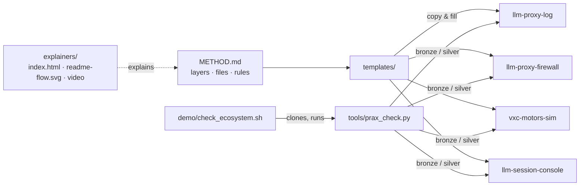

# Architecture · Prax Systems

## Runtime
| Process | Command |
|---|---|
| checker | `python3 tools/prax_check.py <repo> [--level silver] [--json]` |
| ecosystem check | `./demo/check_ecosystem.sh` (uses `../<repo>` if cloned, else a shallow clone in a temp folder) |
| video | `cd explainers/video && npm i && npx remotion render PraxExplainer ../prax-explainer.mp4` |
| tests | `python3 -m unittest discover -s tests` |

## Requirement → code map
| R-id | Where |
|---|---|
| R-001, R-004, R-011 | `tools/prax_check.py:check` (bronze block) |
| R-002, R-005 (manual rows) | `tools/prax_check.py:spec_ids` |
| R-003 | `tools/prax_check.py:check` (PROMPTS block) |
| R-005, R-006, R-007 | `tools/prax_check.py:check` (silver block; R-007 via `EXTERNAL_LOAD`) |
| R-008 | `ecosystem/CONTRACTS.md` |
| R-009 | `tools/prax_check.py` imports |
| R-012, R-013 | `tools/prax_check.py:check` (blueprint and README blocks) |
| R-014 | `demo/check_ecosystem.sh` |
| R-010 | `templates/` |

## Extension points
Add a level (e.g. Gold automation) in `check()`; add a template in `templates/` and a line in METHOD.md §3.
