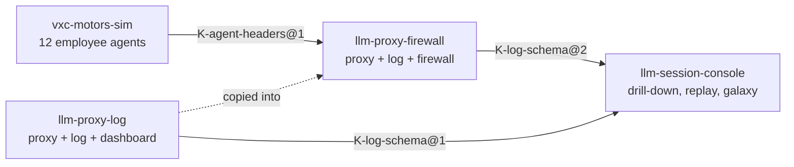

# The ecosystem

Four systems were built with Prax Systems in October and November 2026, first as folders of one
learning project (`agent-session-inspector`), then published as standalone repositories. Each one
clones and runs alone; they fit together only through the [contracts](CONTRACTS.md).

| Repo | What it is | Silver | Explainer | Video |
|---|---|---|---|---|
| [llm-proxy-log](https://github.com/claudiucalomfirescu/llm-proxy-log) | LLM proxy that logs every call per user | ✅ 34/34 R-ids | [open](https://claude.ai/artifact/B6okrEHnusms6PxDMCbbGY) | [55 s](https://github.com/claudiucalomfirescu/llm-proxy-log/blob/main/explainers/proxy-log-explainer.mp4) |
| [llm-proxy-firewall](https://github.com/claudiucalomfirescu/llm-proxy-firewall) | LLM logging proxy with a policy firewall | ✅ 58/58 | [open](https://claude.ai/artifact/9B6TSTeeKKVG2z3yT3fYYN) | [65 s](https://github.com/claudiucalomfirescu/llm-proxy-firewall/blob/main/explainers/firewall-explainer.mp4) |
| [vxc-motors-sim](https://github.com/claudiucalomfirescu/vxc-motors-sim) | Simulated BMW dealership run by LLM agents | ✅ 31/31 | [open](https://claude.ai/artifact/8wC8ce5VHxeCewFyGd2izD) | [80 s](https://github.com/claudiucalomfirescu/vxc-motors-sim/blob/main/explainers/vxc-explainer.mp4) |
| [llm-session-console](https://github.com/claudiucalomfirescu/llm-session-console) | Drill down into and replay LLM agent sessions | ✅ 33/33 | [open](https://claude.ai/artifact/PezDkCy9QLtZon76eJiGnT) | [73 s](https://github.com/claudiucalomfirescu/llm-session-console/blob/main/explainers/console-explainer.mp4) |

Silver results are recorded in [demo/data/check_ecosystem.txt](../demo/data/check_ecosystem.txt)
(13 November 2026). Run [demo/check_ecosystem.sh](../demo/check_ecosystem.sh) to check them again.

## History

Dated snapshots from the split, kept for the record and not updated:
[the master plan](history/MASTER_PLAN.md) (30 Oct), [the first morning report](history/MORNING_REPORT.md)
(31 Oct) and [how the repos were published](history/PUBLISHING.md) (1 Nov).
